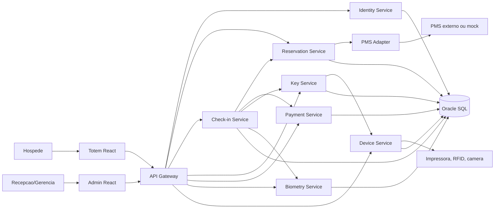
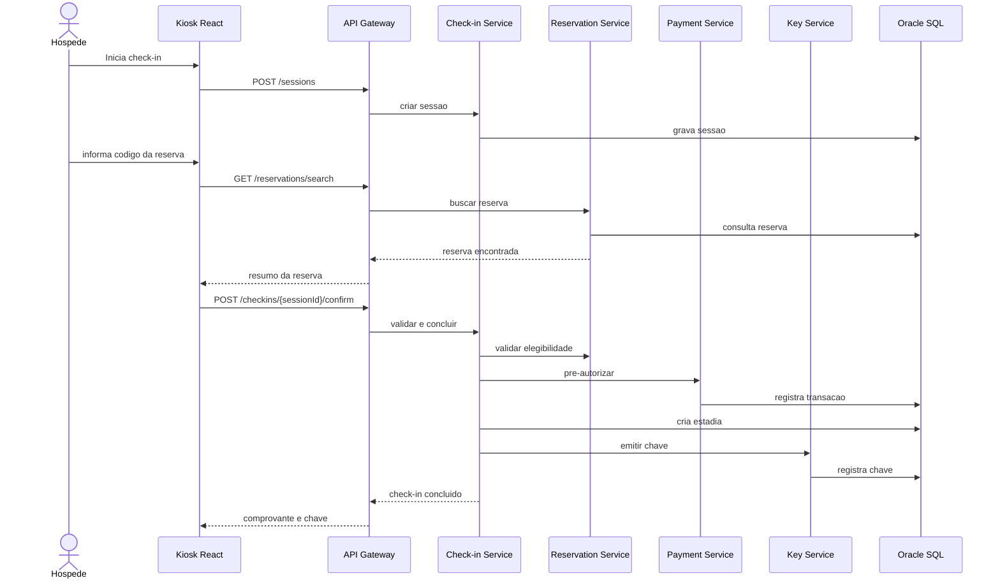

# Arquitetura de Software

## 1. Estilo Arquitetural

A solucao usa microservicos com separacao por dominio de negocio. Para o MVP, alguns servicos podem ser implementados com escopo reduzido ou simulacoes, mas a estrutura preserva a evolucao para integracoes reais.

Decisao importante: o projeto deve evitar excesso de complexidade para a entrega. A arquitetura-alvo e completa, mas o MVP deve priorizar o fluxo funcional.

## 2. Visao Geral

## 3. Microservicos

### api-gateway

Responsavel por entrada unica das aplicacoes, roteamento, validacao basica de token, cabecalhos de correlacao e controle de CORS.

Tecnologia sugerida:

- Spring Cloud Gateway.
- JWT validation.
- Rate limit simples por totem.

### identity-service

Gerencia usuarios administrativos, papeis, permissoes e credenciais tecnicas dos totens.

Entidades principais:

- Usuario.
- Papel.
- Totem autorizado.
- Token tecnico.

### reservation-service

Gerencia reservas locais, consulta disponibilidade e conversa com o adaptador PMS.

Responsabilidades:

- Buscar reserva.
- Validar status.
- Sincronizar dados do PMS.
- Expor dados de quarto e tarifas.

### checkin-service

Orquestra o processo de check-in e check-out. Este e o servico central de negocio.

Responsabilidades:

- Criar sessao.
- Validar elegibilidade.
- Registrar aceite.
- Coordenar documento, biometria, pagamento e chave.
- Criar estadia.
- Encerrar estadia.
- Registrar auditoria.

### key-service

Gera, emite e revoga credenciais de acesso.

No MVP:

- Gera QR Code ou codigo textual de chave.
- Simula cartao fisico.

Na evolucao:

- Integra RFID, fechaduras ou provedor mobile key.

### payment-service

Simula ou integra pagamentos, pre-autorizacoes e capturas.

No MVP:

- Aprova ou recusa transacoes com base em cartoes de teste.

Na evolucao:

- Integra adquirente real e segue requisitos PCI.

### biometry-service

Responsavel por validacao facial opcional e prova de vida.

No MVP:

- Simula resultado de biometria.
- Registra consentimento e status.

Na evolucao:

- Integra provedor especializado e evita armazenamento de imagem bruta.

### device-service

Gerencia o estado dos totens e equipamentos conectados.

Responsabilidades:

- Registrar heartbeat do totem.
- Informar camera, impressora, leitor e emissor de chave.
- Registrar falhas de hardware.

### pms-adapter-service

Camada anti-corrupcao para integrar com PMS.

Responsabilidades:

- Traduzir contratos internos para contratos do PMS.
- Reexecutar chamadas com retry.
- Garantir idempotencia.
- Registrar eventos de reconciliacao.

### notification-service

Envia comprovantes, orientacoes e chaves digitais.

No MVP:

- Registra envio simulado.

Na evolucao:

- Integra e-mail, SMS ou WhatsApp.

## 4. Comunicacao

Para o MVP:

- REST entre frontend e gateway.
- REST entre servicos.
- Eventos persistidos em Oracle para auditoria e integracao assíncrona simples.

Para evolucao:

- Mensageria com RabbitMQ ou Kafka, se permitido pelo curso e pelo ambiente.
- Padrao Outbox para consistencia entre banco e eventos.

## 5. Padroes Aplicados

- API Gateway: entrada unica e roteamento.
- BFF leve: o gateway pode agregar respostas para telas do totem.
- Saga orquestrada: check-in coordena pagamento, quarto e chave.
- Anti-corruption Layer: adaptador PMS isola o dominio de contratos externos.
- Idempotency Key: evita duplicidade em check-in, pagamento e chave.
- Audit Log: rastreia operacoes criticas.
- Circuit Breaker: evita travamento quando PMS ou pagamentos falham.
- Feature Flag: habilita biometria, chave fisica e PMS real por hotel.

## 6. Fluxo de Check-in Tecnico

## 7. Banco de Dados

Como a faculdade oferece Oracle SQL, a proposta usa Oracle como banco transacional. Em arquitetura ideal, cada microservico teria seu proprio schema. Para o MVP, pode haver uma unica instancia Oracle com tabelas separadas por prefixo ou por ownership documentado.

Estrategia recomendada:

- Um usuario/schema Oracle para o projeto no MVP.
- Tabelas nomeadas por dominio.
- Evolucao futura para schemas separados por servico.
- Migrations com Flyway ou Liquibase, se permitido.

## 8. Frontend

### kiosk-web

Aplicacao React otimizada para tela de totem:

- Fluxo guiado.
- Botoes grandes.
- Pouco texto por tela.
- Feedback visual de progresso.
- Estados de erro com encaminhamento.

### admin-web

Aplicacao React para recepcao e gestao:

- Reservas do dia.
- Sessoes em andamento.
- Falhas de totem.
- Check-ins e check-outs recentes.
- Acoes de suporte manual.

## 9. Seguranca

- JWT para operadores.
- Token tecnico por totem.
- HTTPS em producao.
- Senhas com BCrypt.
- Segredos fora do codigo.
- Logs sem dados sensiveis.
- Criptografia para dados biometricos ou referencias sensiveis.
- Auditoria em operacoes criticas.

## 10. Observabilidade

Cada requisicao deve carregar:

- `correlationId`.
- `sessionId`, quando existir.
- `kioskId`, quando vier do totem.
- `reservationId`, quando aplicavel.

Indicadores a exibir:

- Check-ins concluidos.
- Check-outs concluidos.
- Tempo medio por etapa.
- Falhas por motivo.
- Status dos totens.
- Eventos pendentes de reconciliacao PMS.

## 11. Riscos Arquiteturais

| Risco | Impacto | Mitigacao |
| --- | --- | --- |
| Microservicos demais para o prazo | Alto | Implementar MVP com servicos essenciais e mocks claros |
| PMS real indisponivel | Alto | PMS Adapter mockado e contrato documentado |
| Biometria complexa | Medio | Simular fluxo e tratar LGPD corretamente |
| Oracle local dificil | Medio | Scripts SQL simples e possibilidade de usar banco da faculdade |
| Demo falhar | Alto | Preparar dados seed, roteiro curto e fallback gravado |
| Escopo crescer | Alto | Tratar extras como diferenciais, nao como obrigatorios |

## 12. Decisoes de Arquitetura

### ADR-001 - Java e Spring Boot no backend

Escolha: Java com Spring Boot.

Motivo: stack comum em sistemas corporativos, boa integracao com Oracle, seguranca e APIs REST.

### ADR-002 - React no totem e no painel

Escolha: React com TypeScript.

Motivo: permite experiencia rica, componentes reutilizaveis e simulacao facil de estados do totem.

### ADR-003 - Oracle SQL como banco principal

Escolha: Oracle SQL.

Motivo: disponibilidade pela faculdade e aderencia a sistemas empresariais.

### ADR-004 - PMS via adaptador

Escolha: isolar PMS em um microservico adaptador.

Motivo: PMS variam muito. O dominio interno nao deve depender de contratos externos.

### ADR-005 - Biometria opcional

Escolha: biometria nunca deve ser caminho unico.

Motivo: LGPD, acessibilidade, falso negativo e necessidade de atendimento inclusivo.

