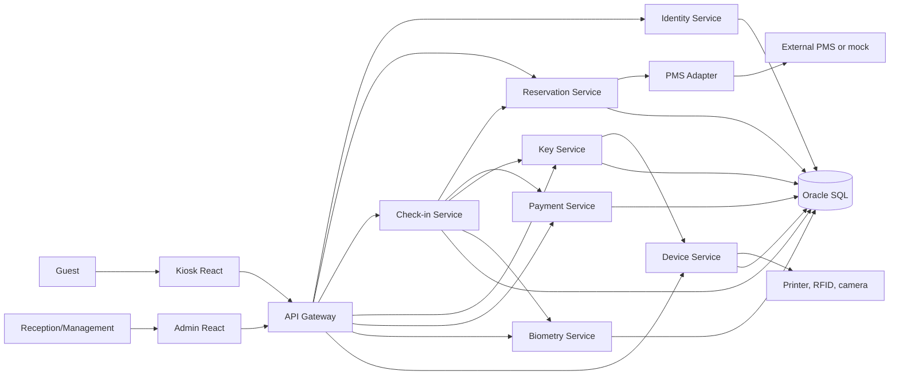
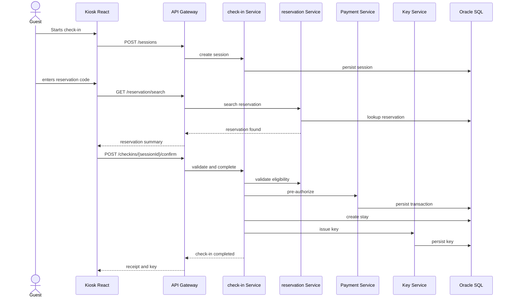

# Software Architecture

## 1. Architectural Style

The solution uses microservices separated by business domain. For the MVP, some services may be implemented with a reduced scope or with simulated behavior, but the structure preserves the path toward real integrations.

The key decision is to avoid unnecessary complexity during delivery. The target architecture is complete, but the MVP should prioritize the functional flow.

## 2. Overview

## 3. Microservices

### api-gateway

Single entry point for the applications, handling routing, basic token validation, correlation headers, and CORS control.

Suggested technology:

- Spring Cloud Gateway
- JWT validation
- Simple rate limiting per kiosk

### identity-service

Manages administrative users, roles, permissions, and kiosk technical credentials.

Main entities:

- User
- Role
- Authorized kiosk
- Technical token

### reservation-service

Manages reservations, local lookup, and PMS adapter communication.

Responsibilities:

- Search for reservations
- Validate status
- Synchronize PMS data
- Expose room and rate data

### checkin-service

Orchestrates the check-in and check-out process. This is the central business service.

Responsibilities:

- Create sessions
- Validate eligibility
- Register consent
- Coordinate documents, biometrics, payment, and key issuance
- Create stays
- Close stays
- Register audit events

### key-service

Generates, issues, and revokes access credentials.

In the MVP:

- Generates QR code or textual key credentials
- Simulates a physical card

In the evolution path:

- Integrates RFID, locks, or a mobile key provider

### payment-service

Simulates or integrates payments, pre-authorizations, and captures.

In the MVP:

- Approves or declines transactions based on test cards

In the evolution path:

- Integrates a real acquirer and follows PCI requirements

### biometry-service

Handles optional facial validation and liveness checks.

In the MVP:

- Simulates biometric results
- Records consent and status

In the evolution path:

- Integrates a specialized provider and avoids storing raw images

### device-service

Manages kiosk and connected hardware status.

Responsibilities:

- Register kiosk heartbeat
- Report printer, camera, reader, and key emitter status
- Register hardware failures

### pms-adapter-service

Anti-corruption layer for PMS integration.

Responsibilities:

- Translate internal contracts into PMS contracts
- Retry calls
- Guarantee idempotency
- Record reconciliation events

### notification-service

Sends receipts, guidance, and digital key notifications.

In the MVP:

- Records simulated delivery events

In the evolution path:

- Integrates e-mail, SMS, or WhatsApp

## 4. Communication

For the MVP:

- REST between the frontend and the gateway
- REST between services
- Events persisted in Oracle for audit and simple asynchronous integration

For future evolution:

- Messaging with RabbitMQ or Kafka, if permitted
- Outbox pattern for consistency between the database and events

## 5. Applied Patterns

- API Gateway: single entry point and routing
- Lightweight BFF: the gateway may aggregate responses for kiosk screens
- Orchestrated saga: check-in coordinates payment, room, and key issuance
- Anti-corruption layer: the PMS adapter isolates the domain from external contracts
- Idempotency key: prevents duplication in check-in, payment, and key issuance
- Audit log: traces critical operations
- Circuit breaker: prevents lockups when PMS or payment is unavailable
- Feature flag: enables biometrics, physical keys, and real PMS by hotel

## 6. Technical Check-in Flow

## 7. Database

The faculty provides Oracle SQL, so the solution uses Oracle as the primary transactional database. In the ideal architecture, each microservice would have its own schema. For the MVP, a single Oracle instance with tables separated by domain ownership is acceptable.

Recommended strategy:

- one Oracle user or schema for the project in the MVP;
- tables named by domain;
- future evolution toward service-specific schemas;
- migrations using Flyway or Liquibase, if permitted.

## 8. Frontend

### kiosk-web

React application optimized for kiosk usage:

- guided flow
- large buttons
- limited copy per screen
- clear progress feedback
- explicit error states with assisted service routing

### admin-web

React application for reception and management:

- reservations for the day
- active sessions
- kiosk failures
- recent check-ins and check-outs
- manual support actions

## 9. Security

- JWT for operators
- Technical token per kiosk
- HTTPS in production
- BCrypt for passwords
- Secrets stored outside the codebase
- Logs without sensitive data
- Encryption for biometric data or sensitive references
- Audit trail for critical operations

## 10. Observability

Each request should carry:

- `correlationId`
- `sessionId`, when available
- `kioskId`, when provided by the kiosk
- `reservationId`, when applicable

Recommended metrics:

- completed check-ins
- completed check-outs
- average time per step
- failures by reason
- kiosk status
- pending PMS reconciliation events

## 11. Architectural Risks

| Risk | Impact | Mitigation |
| --- | --- | --- |
| Too many microservices for the schedule | High | Deliver an MVP with the essential services and clear mocks |
| Real PMS unavailable | High | Use a mocked PMS adapter and document the contract |
| Biometric complexity | Medium | Simulate the flow and address LGPD correctly |
| Oracle setup is difficult locally | Medium | Keep SQL scripts simple and allow the faculty database as an alternative |
| Demo failure | High | Prepare seed data, a short demo script, and a recorded fallback |
| Scope expansion | High | Treat extras as differentiators, not as requirements |

## 12. Architectural Decisions

### ADR-001 - Java and Spring Boot for the backend

Choice: Java with Spring Boot.

Reason: this is a common enterprise stack, integrates well with Oracle, and fits REST APIs.

### ADR-002 - React for kiosk and dashboard

Choice: React with TypeScript.

Reason: it enables a rich experience, reusable components, and easy state simulation.

### ADR-003 - Oracle SQL as the primary database

Choice: Oracle SQL.

Reason: it is available through the faculty environment and matches enterprise systems.

### ADR-004 - PMS through an adapter

Choice: isolate PMS in a dedicated adapter microservice.

Reason: PMS providers vary significantly, and the internal domain should not depend on external contracts.

### ADR-005 - Optional biometrics

Choice: biometrics must never be the only path.

Reason: LGPD, accessibility, false negatives, and the need for inclusive service.
