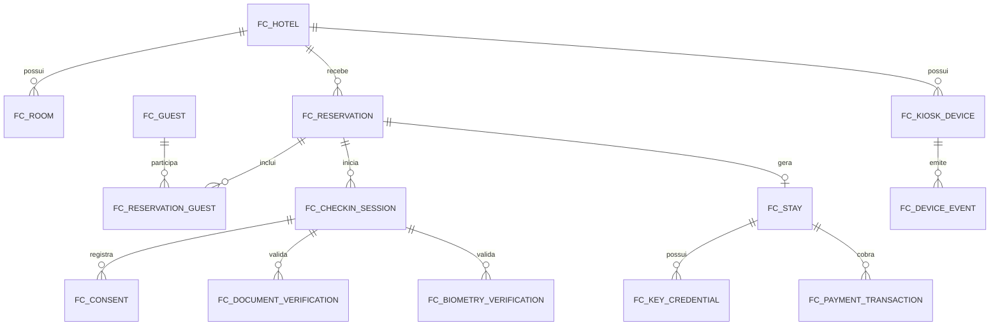

# Modelagem de Dados Oracle

## 1. Estrategia

O MVP usa Oracle SQL como banco transacional unico. Mesmo com banco unico, cada tabela possui ownership claro por dominio, facilitando evolucao para schemas separados por microservico.

Ownership sugerido:

- `FC_HOTEL`, `FC_ROOM`: reservation-service.
- `FC_RESERVATION`, `FC_RESERVATION_GUEST`: reservation-service.
- `FC_GUEST`, `FC_CONSENT`: checkin-service ou guest-profile futuro.
- `FC_CHECKIN_SESSION`, `FC_STAY`: checkin-service.
- `FC_DOCUMENT_VERIFICATION`: checkin-service.
- `FC_BIOMETRY_VERIFICATION`: biometry-service.
- `FC_PAYMENT_TRANSACTION`: payment-service.
- `FC_KEY_CREDENTIAL`: key-service.
- `FC_KIOSK_DEVICE`, `FC_DEVICE_EVENT`: device-service.
- `FC_PMS_EVENT`: pms-adapter-service.
- `FC_AUDIT_LOG`: plataforma/auditoria.

## 2. Entidades Principais

### Hotel

Representa uma unidade hoteleira.

Campos principais:

- `id`
- `name`
- `timezone`
- `checkin_time`
- `checkout_time`
- `early_checkin_minutes`
- `late_checkout_minutes`

### Quarto

Representa acomodacao fisica.

Status principais:

- `AVAILABLE`
- `OCCUPIED`
- `CLEANING`
- `MAINTENANCE`
- `BLOCKED`

### Hospede

Dados pessoais minimos para hospedagem e integracao.

Campos sensiveis devem ter acesso controlado e nunca aparecer em logs.

### Reserva

Registro de hospedagem antes do check-in.

Status principais:

- `CONFIRMED`
- `CANCELLED`
- `NO_SHOW`
- `CHECKED_IN`
- `CHECKED_OUT`

### Sessao de Check-in

Representa uma tentativa de atendimento no totem.

Status principais:

- `STARTED`
- `RESERVATION_FOUND`
- `DATA_CONFIRMED`
- `PAYMENT_APPROVED`
- `CHECKED_IN`
- `CHECKED_OUT`
- `FAILED`
- `EXPIRED`
- `HANDOFF`

### Estadia

Representa a ocupacao real apos check-in.

Status principais:

- `ACTIVE`
- `PENDING_KEY`
- `CHECKED_OUT`
- `CANCELLED`

### Chave

Credencial de acesso fisica ou digital.

Status principais:

- `ISSUED`
- `ACTIVE`
- `REVOKED`
- `EXPIRED`
- `FAILED`

### Pagamento

Transacao financeira do fluxo.

Tipos:

- `PRE_AUTH`
- `CAPTURE`
- `SALE`
- `REFUND`

Status:

- `APPROVED`
- `DECLINED`
- `PENDING`
- `CANCELLED`
- `ERROR`

## 3. Relacionamentos

## 4. Retencao de Dados

Sugestao para o projeto:

- Auditoria: manter durante periodo definido pelo hotel.
- Consentimentos: manter enquanto necessario para comprovacao legal.
- Imagens de documento: nao armazenar no MVP.
- Biometria: armazenar apenas resultado e referencia tecnica, nao imagem bruta.
- Sessoes expiradas: remover dados temporarios ou anonimizar.

## 5. Criacao do Banco

O caminho principal do backend agora e criar as tabelas pelas entidades JPA, mantendo `JPA_DDL_AUTO=update`.

As entidades ficam em:

- `backend/services/checkin-service/src/main/java/br/com/fiap/flexcheck/checkin/infrastructure/persistence/entity`

## 6. Arquivos SQL de Apoio

O DDL inicial esta em:

- `database/oracle/schema.sql`

Os dados de demonstracao estao em:

- `database/oracle/seed.sql`
