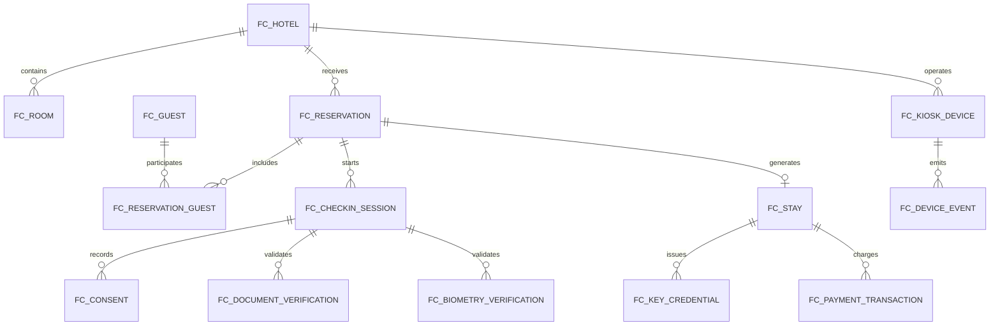

# Oracle Data Model

## 1. Data Strategy

FlexCheck Hotel uses Oracle as the operational system of record for the MVP. The database is shared across services in the current delivery, but every table still has a clear logical owner. This keeps the model coherent today and prepares it for a future migration to service-specific persistence.

Recommended ownership model:

- `FC_HOTEL`, `FC_ROOM`: reservation service
- `FC_RESERVATION`, `FC_RESERVATION_GUEST`: reservation service
- `FC_GUEST`, `FC_CONSENT`: check-in service or a future guest profile service
- `FC_CHECKIN_SESSION`, `FC_STAY`: check-in service
- `FC_DOCUMENT_VERIFICATION`: check-in service
- `FC_BIOMETRY_VERIFICATION`: biometry service
- `FC_PAYMENT_TRANSACTION`: payment service
- `FC_KEY_CREDENTIAL`: key service
- `FC_KIOSK_DEVICE`, `FC_DEVICE_EVENT`: device service
- `FC_PMS_EVENT`: PMS adapter service
- `FC_AUDIT_LOG`: platform audit service

## 2. Core Entities

### Hotel

Represents a hotel property and its operational configuration.

Primary attributes:

- `id`
- `name`
- `timezone`
- `checkin_time`
- `checkout_time`
- `early_checkin_minutes`
- `late_checkout_minutes`

### Room

Represents a physical accommodation unit within a hotel.

Typical statuses:

- `AVAILABLE`
- `OCCUPIED`
- `CLEANING`
- `MAINTENANCE`
- `BLOCKED`

### Guest

Stores the minimum personal data required to complete hospitality operations and external integrations.

Sensitive attributes must remain access-controlled and must never be exposed through logs or debug output.

### Reservation

Represents the booking before check-in and anchors the guest journey.

Typical statuses:

- `CONFIRMED`
- `CANCELLED`
- `NO_SHOW`
- `CHECKED_IN`
- `CHECKED_OUT`

### Check-in Session

Represents a kiosk execution attempt and provides traceability for the user journey.

Typical statuses:

- `STARTED`
- `RESERVATION_FOUND`
- `DATA_CONFIRMED`
- `PAYMENT_APPROVED`
- `CHECKED_IN`
- `CHECKED_OUT`
- `FAILED`
- `EXPIRED`
- `HANDOFF`

### Stay

Represents the actual occupancy created after a successful check-in.

Typical statuses:

- `ACTIVE`
- `PENDING_KEY`
- `CHECKED_OUT`
- `CANCELLED`

### Key

Represents a physical or digital access credential issued for the stay.

Typical statuses:

- `ISSUED`
- `ACTIVE`
- `REVOKED`
- `EXPIRED`
- `FAILED`

### Payment Transaction

Represents a financial transaction generated during the guest journey.

Common types:

- `PRE_AUTH`
- `CAPTURE`
- `SALE`
- `REFUND`

Common statuses:

- `APPROVED`
- `DECLINED`
- `PENDING`
- `CANCELLED`
- `ERROR`

## 3. Entity Relationships

## 4. Data Retention

Recommended retention guidance:

- audit records: retain according to hotel policy and operational compliance needs;
- consent records: retain while legal proof remains required;
- document images: do not persist them in the MVP;
- biometrics: store only the result and technical reference, never the raw image;
- expired sessions: remove temporary data or anonymize it when appropriate.

## 5. Database Bootstrap

The preferred bootstrap path is to create the initial schema with the SQL scripts stored in the repository, then let the service layer manage the data through the domain model and repository contracts.

Relevant implementation files:

- `database/oracle/schema.sql`
- `database/oracle/seed.sql`

## 6. Implementation Notes

The current delivery keeps persistence intentionally simple and explicit:

- the schema is owned by the repository;
- the service layer exposes the domain rules;
- the UI consumes only the API contract;
- support tables remain isolated by functional responsibility.

This approach keeps the MVP stable while leaving room for a later migration to independent service-owned schemas.
